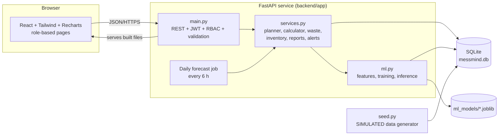

# Architecture

## Data model (SQLite)
`users` - `dishes` - `ingredients` - `recipe_items` (dish x ingredient x qty/serving) - `menu` (weekday x meal x dish) - `menu_overrides` (date x meal x dish) - `events` (holiday/event/exam/break) - `meal_records` (attendance, weather, `is_synthetic`) - `dish_records` (prepared, served, **leftover**, **plate_waste**, shortage, discarded) - `forecasts` / `forecast_dishes` (stored predictions, kind = forecast | backtest) - `feedback` - `purchases` - `model_runs` (every training run, all metrics) - `settings`.

Unserved leftover and plate waste are separate columns end to end (API, charts, reports).

## Request flow: "How much should we cook tomorrow?"
1. `POST /api/plan` -> `services.plan_day` -> for each meal `plan_meal`.
2. `ml.predict_attendance` builds features (weekday, meal, calendar flags, weather, menu appeal, last-same-weekday attendance) -> selected model -> value + 80% interval (from hold-out RMSE).
3. `ml.predict_dishes` predicts grams per student for every dish -> x attendance = demand.
4. Buffer (default 7%, adjusted per dish by recent leftovers/shortages) -> cooking kg -> servings -> recipe -> ingredient needs -> compare with stock -> purchase list and cost.
5. Result is stored in `forecasts` (unless it is a what-if) so it can later be compared with actuals.

## Security
PBKDF2-SHA256 password hashes, signed JWT (12 h), role checks on every route (`require(...)`), pydantic validation on every body, parameterised SQL only, login throttling, security headers, vegetarian-only enforcement (name filter + `CHECK(is_veg=1)`), CORS allow-list, production refuses the default secret.
